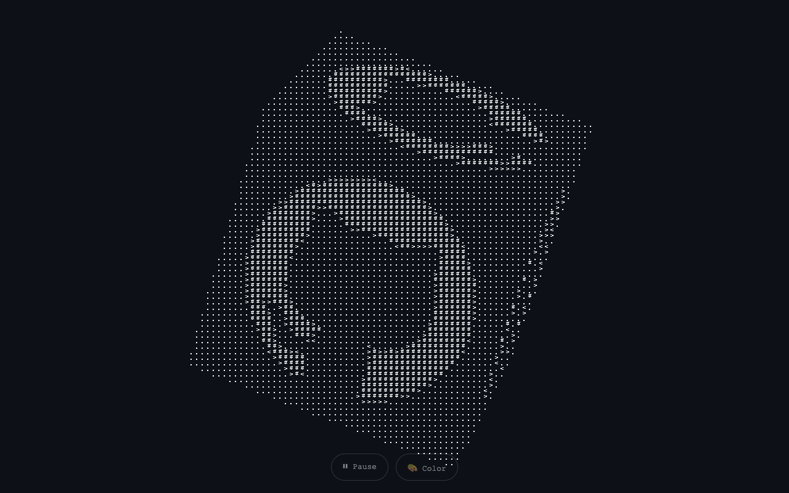

# GitHub ASCII Cube

[Live demo](https://manaiakalani.github.io/github-ascii-cube/)

A rotating cube textured with the GitHub Mona logo, drawn as ASCII by a GLSL post-process shader. It recreates the cube in the [GitHub Shop](https://thegithubshop.com) footer: Mona on a box, rendered with the character ramp of two spaces, `.`, `<`, `>`, `#`.



Three.js r170 loads from jsDelivr. The page is `index.html`. [`about.html`](https://manaiakalani.github.io/github-ascii-cube/about.html) is a short write-up of the same pipeline.

## Run it

Serve the folder, then open the page. The script is an ES module, and the Mona texture and Three.js both come from the network.

```bash
python3 -m http.server 8080
```

Open http://localhost:8080.

Docker publishes the same files:

```bash
docker compose up
```

nginx listens on port 80 inside the container and Compose maps that to http://localhost:8080.

## Controls

The scene canvas is focused on load.

| Input | Action |
| --- | --- |
| Left / Right | Rotate around Y, and set the auto-spin direction |
| Up / Down | Rotate around X |
| Drag | Free rotation. Pointer events cover mouse and touch |
| Pause | Stop or resume the render loop |
| Color | Fade a rotating gradient in or out over 500ms |

Pause stops drawing, so drag and arrow keys show up again after Play. Arrow keys need the canvas focused.

## How it is drawn

Three.js draws a `BoxGeometry(50, 50, 50, 32, 32, 32)` with a `MeshStandardMaterial`. The texture is the GitHub Shop Mona image. If that request is blocked, the page paints an Invertocat onto a canvas and uses that instead.

`EffectComposer` runs a `RenderPass`, then a `ShaderPass`. The fragment shader:

1. Snaps the frame to a cell grid.
2. Converts each cell to greyscale with ITU-R BT.709 weights (`0.2126`, `0.7152`, `0.0722`), then inverts it.
3. Picks one of the six characters from a canvas atlas.
4. Sharpens the glyph with a 5-tap Laplacian (`5 * center - neighbors`) and `smoothstep`.

Cell size follows the viewport width: 4px below 480, 5px below 768, 6px below 1024, and 9px from 1024 up. Device pixel ratio is capped at 2. Resize is debounced by 100ms and the previous atlas texture is disposed.

Rotation is a quaternion slerp toward a target, with damping `0.25`. An auto-spin of `0.0025` radians per frame keeps turning the target until you pause. The loop also pauses while the tab is hidden. The entrance scales the cube in over 2.2 seconds.

## GitHub Pages

[`.github/workflows/pages.yml`](.github/workflows/pages.yml) publishes `index.html` and `about.html` on every push to `master`. The live site is https://manaiakalani.github.io/github-ascii-cube/.

## License

[MIT](LICENSE)

Built by [@Manaiakalani](https://github.com/Manaiakalani).
